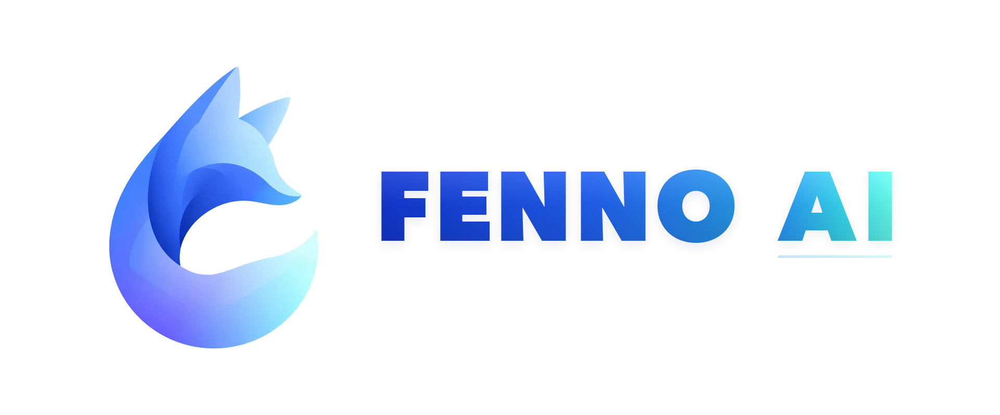
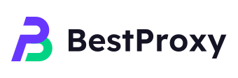
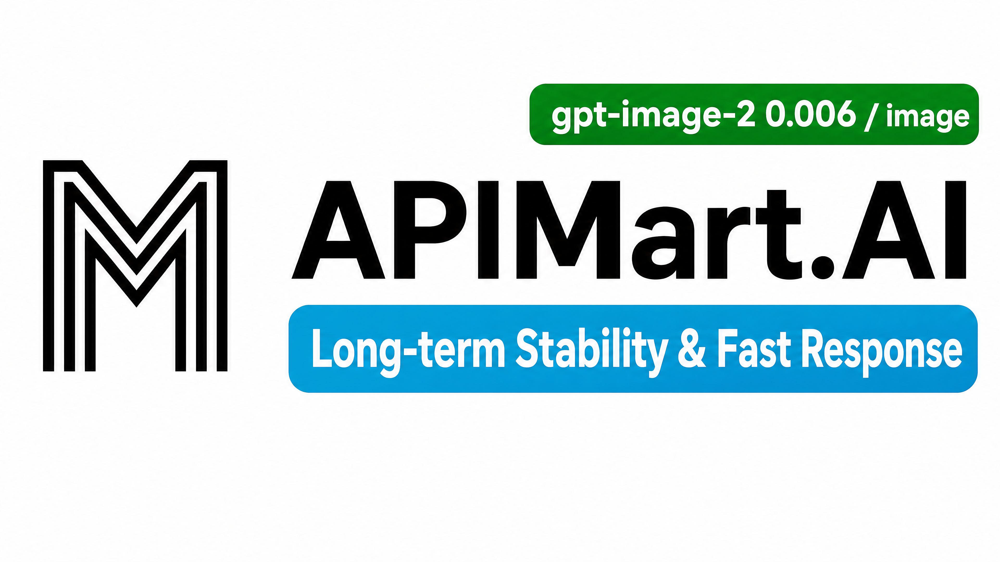
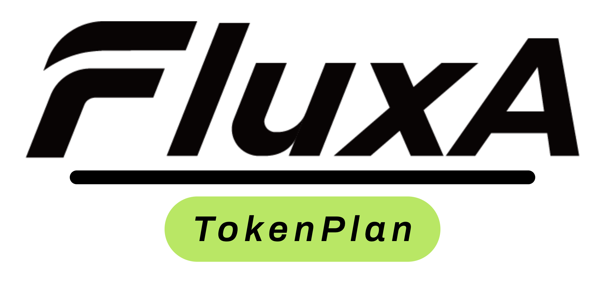

# CPA 自用分支

这是基于 [router-for-me/CLIProxyAPI](https://github.com/router-for-me/CLIProxyAPI) 维护的自用分支，用于保留个人场景中的兼容性补丁和运行增强。

## 当前基线

上游基线：`v7.2.122`

自用版本：`v7.2.122-selfuse.20260807.1`

## 改动概要

### Codex 上下文过长处理

当上游返回 `context_too_large`、`context_length_exceeded` 等错误时，该分支将错误交回客户端处理，不在中间层压缩或改写历史后继续重试。

### 加密 reasoning 降级重试

当上游拒绝 `input[*].encrypted_content`，或返回 stale reasoning item 相关错误时，该分支会移除无效 reasoning 上下文并重试一次。

### 上游 v7.2.116

- Home OAuth 遇到上游 401 时自动刷新凭据并重试，增强凭据禁用、刷新后重新准备和并发选择逻辑。
- Claude OAuth 身份、TLS、请求头伪装、fast mode、诊断、签名和 Responses reasoning chain 全面重构。
- Codex 补齐缺失的 `response.completed` 输出项 ID；Antigravity 清理 `propertyNames` schema；HTTP partial write 状态得以保留。
- 新增 Claude/Home/HTTP 等相关回归测试，并增强 token fingerprint、usage 和 OAuth wire 行为。

### 上游 v7.2.117 ~ v7.2.122

- v7.2.117：Responses 补充 `reasoning_tokens` 输出；Codex/Claude 转换修复；Multi-Agent V2 工具定义和 `multi_agent_version=v2`。
- v7.2.118：Grok Imagine Video 1.5 GA；Grok Shell 相关模型路由；Antigravity 敏感词伪装；prepared route skip 修复。
- v7.2.119：OpenAI 流式 `[DONE]` 后丢弃多余分块；README 增加 EasyCLIProxyAPI 推荐。
- v7.2.120：XAI 客户端版本提升并加入 Grok Shell 认证头；Responses 自定义工具调用和命名冲突处理。
- v7.2.121：凭据冷却与失败分类优化，客户端错误不惩罚凭据；Claude/Responses 连续轮次合并；is-compat 与 thinking summary 改进。
- v7.2.122：Codex input item ID 规范化；is-compat 模型保留 Claude thinking/工具调用内容。

### 上游 v7.2.91 ~ v7.2.115

- v7.2.91：过长 encrypted reasoning ID 发送前丢弃，其它过长 input item ID 确定性截短。
- v7.2.92：`GetGJSONBytesNoCopy` 与 payload `Set*IfDifferent` 等性能优化。
- v7.2.93：WebSocket 上游 1009 按请求级错误透传（不换号/cooldown）；docker-compose 插件目录挂载。
- v7.2.94：管理 API 按 name/auth_index 过滤认证文件；插件 stream bridge close/send 竞态修复。
- v7.2.95：Codex Alpha Search 模型路由；Claude 输入 token 估算；XAI token 计数优化（O200k）；OpenAI translator tools 字段优化。
- v7.2.96：Home 凭据并发（credential concurrency / in-flight）支持。
- v7.2.97：Responses WebSocket 上下文连续性（含 XAI compacted transcript）；usage token 规范化记账 v2。
- v7.2.98：Codex Multi-Agent V2 优化（`optimize-multi-agent-v2`，默认关闭）；credential concurrency / sentinel 测试整理。
- v7.2.99：Codex Live 会话（WebRTC 媒体中继、TCP proxy）；Codex 与 Claude 客户端模型目录。
- v7.2.100：Windows 插件响应缓冲修复；Antigravity 完整 reasoning 重放；Claude 响应重复 delta 修复；deferred tools 跳过 `cache_control`；新增 Claude Opus 5 与 Gemini 3.6 Flash。
- v7.2.101：xAI executor 输出控制增强；Codex 流式翻译保持单 thinking block；cloaking 提示注入时保持 `tool_result` 在前；派生会话身份；pluginhost 与大文件拆分重构。
- v7.2.102：xAI 可配置注入 x_search；PostgreSQL cooldown 持久化；工具名冲突处理；OpenAI [DONE]/completion 状态修复；Claude 本地 token 估算与 OAuth SSE 工具名恢复；Codex replay 指纹 O(n) 优化；SDK 保留自定义 executor。
- v7.2.103：会话亲和性优先原生 session 信号；Claude 可关 model list cloaking；工具 input schema 规范化与 input_image 解析；OpenAI response_format 映射 Gemini；Gemini 3.1/3.5/3.6 元数据；Codex minimal reasoning；request lifecycle 插件；auth 文件删除保护。
- v7.2.104：凭据权重校验与加权轮询；请求客户端 IP、User-Agent 等元数据向插件传递；Home 集群接管与恢复逻辑增强。
- v7.2.105：Claude 请求中连续 tool result 合并；Codex/Claude 函数调用翻译重构；Antigravity schema 和响应格式兼容增强。
- v7.2.106：JSON Schema 清理改为结构化选项；停止强制注入 Codex 内置模型 ID。
- v7.2.107：Codex 模型解析与凭据校验修复；`json_schema` / `json_object` 响应格式修复；Git 存储库损坏恢复增强。
- v7.2.108：认证文件支持解析凭据权重。
- v7.2.109：简化 Codex 模型选择，未显式配置时恢复默认 Codex Pro 模型。
- v7.2.110：新增 `disable-codex-cloaking`，可关闭 Codex `User-Agent` 和 `Originator` 请求头伪装，并完善配置热更新检测。
- v7.2.111：Home OAuth 凭据遇到 401 时自动刷新恢复，避免凭据过早进入冷却；新增 Kimi K3 256K 模型配置。
- v7.2.112：回退 v7.2.111 的 Home 401 刷新恢复；新增 thinking summary 跨协议可见性转换体系，统一 Claude/Gemini/Antigravity/Interactions 之间的 reasoning summary 处理。
- v7.2.113：Codex WebSocket cloaking 请求头对齐；OpenAI-compatible 新增 support-prompt-cache-key；Claude fast mode beta 条件支持；OpenAI 结构化工具输出响应增强；Codex Alpha Search API key 可配置端点；Kimi Thinking Replay 缓存与连续性机制。
- v7.2.114：修复 Home client 空闲连接未安全关闭的问题；Codex/Claude token 刷新路径增加有界超时；Codex 输入清理规范化无效 sub2api 消息 item ID；Codex 支持按模型配置 max-context-length 覆盖。
- v7.2.115：translator 多项修复——finish_reason 缺失时流结束发出 response.completed、保留非对象 Claude tool inputs、保留内容块顺序、function call stream 事件幂等化、Gemini snake_case usage 兼容；OpenAI 工具结果规范化以兼容纯文本模型；处理加密 collaboration message schema。

### Codex incomplete stream

合并上游 `v7.2.80` 的 incomplete stream / request-scoped 错误处理：`response.incomplete` 按终端成功处理，避免把可结束的截断流误判为 502。

### XAI reasoning replay

合并上游 `v7.2.77` 的加密 reasoning replay：支持 Responses/Claude 会话回放，并包含压缩后清理、调用方隔离、纯工具调用批次保留和歧义注入防护。

### XAI 工具历史兼容

向 Grok Responses 路由 Codex 会话时，将 `custom_tool_call` 历史转换为 XAI 支持的函数调用格式；对于 XAI 不支持且已过滤的 `apply_patch` 工具，其调用与输出历史会成对移除。`tool_search_call` 与 `tool_search_output` 历史也会在发送给 XAI 前移除，避免上游返回 `ModelInput` 反序列化错误。

### Codex 响应头超时

该分支保留 `codex-response-header-timeout-seconds` 配置，用于限制等待 Codex 响应头的时间。响应头到达后的流式正文不受该超时限制。

### OpenAI-compatible JSON 预检

该分支对部分 OpenAI-compatible 输入中的 JSON 转义问题做入口预检和兼容处理。

### 管理界面增强

该分支保留 auth 文件测试、批量测试和账号测试结果展示等管理界面增强。简略模式下的认证文件动作区使用独立布局，避免状态文字、开关和测试按钮重叠。

## 上游关系

- 通用修复来自上游实现。
- 自用运行补丁保留在该分支。
- 上游合并记录保留在 Git 历史中。

## 许可证

本仓库继承上游项目的许可证。详情见 [LICENSE](LICENSE)。

---

## 上游 README

# CLI Proxy API

English | [中文](README_CN.md) | [日本語](README_JA.md)

If you want to use CLIProxyAPI on your desktop, we recommend our [EasyCLIProxyAPI](https://github.com/router-for-me/EasyCLIProxyAPI) desktop client. It provides a graphical configuration UI, automatic updates, system tray integration, and one-click start/stop for the CLIProxyAPI service.

CLIProxyAPI is a proxy server that provides OpenAI/Gemini/Claude/Codex/Grok compatible API interfaces for CLI.

You can access the following providers locally and with multiple CLI accounts through any OpenAI (including Responses), Gemini (including Interactions), or Claude-compatible client or SDK.

<table>
<tbody>
    <tr>
        <th align="center" width="100">Provider</th>
        <th align="center">Description</th>
    </tr>
    <tr>
        <td align="center"></td>
        <td>Kimi series models (Kimi K3, K2.8 Preview, etc.). <a href="https://platform.kimi.ai/docs/guide/kimi-k3-quickstart">Kimi K3</a> is Moonshot AI’s most capable model and the world’s first open 3T-class model. With 2.8 trillion parameters, native vision, and a 1-million-token context window, K3 is built for long-horizon coding, knowledge work, and reasoning. CLIProxyAPI supports Kimi through OAuth or compatible API interfaces. Try a <strong>Kimi Code plan</strong> (<a href="https://www.kimi.com/code?aff=cliproxyapi">中文站</a> | <a href="https://www.kimi.ai/code?aff=cliproxyapi">Global</a>), or get an <strong>API key</strong> from the Kimi Open Platform (<a href="https://platform.kimi.com?track_id=track-f15622e7182046baa22ca35e006e13a7&aff=cliproxyapi">中文站</a> | <a href="https://platform.kimi.ai?track_id=track-8a28e4b291d84f62af2fccc3e7a21cb3&aff=cliproxyapi">Global</a>). Thanks to Kimi for supporting CLIProxyAPI and the open-source community!</td>
    </tr>
    <tr>
        <td align="center"></td>
        <td>OpenAI GPT-6 models (GPT-6 Astra, GPT-6.1 Sol, GPT-6 Luna), including access through Codex OAuth. Astra is the flagship for complex reasoning and coding, Sol balances capability and cost, and Luna handles focused, high-volume work.</td>
    </tr>
    <tr>
        <td align="center"></td>
        <td>Anthropic Claude models (Claude Fable 5.1, Claude Opus 5.5, Claude Sonnet 5.5). Fable 5.1 is built for ambitious, long-running coding and knowledge work; Opus 5.5 brings strong agentic coding at a lower cost.</td>
    </tr>
    <tr>
        <td align="center"></td>
        <td>Google Gemini models include Gemini 3.8 Flash and Gemini 3.1 Pro Preview. CLIProxyAPI supports Gemini API, AI Studio, Vertex AI, Gemini CLI, and Antigravity accounts; model availability varies by channel. Gemini 3.8 Flash is Google's latest Flash model for long-horizon software engineering and agentic workflows.</td>
    </tr>
    <tr>
        <td align="center"></td>
        <td>xAI Grok models (Grok 4.7, Grok 4.7 Build Fast, etc.). Grok 4.7 is SpaceXAI's latest model for coding, agentic tasks, and knowledge work.</td>
    </tr>
    <tr>
        <td align="center"></td>
        <td>Meta Muse models (Muse Spark 1.3, Muse Spark 1.2, etc.). CLIProxyAPI supports Muse Code accounts through Meta login and Meta Model API keys, with Muse Spark 1.3 for coding and agentic workflows.</td>
    </tr>
    <tr>
        <td align="center"><a href="https://devin.ai/cli">Devin</a></td>
        <td>Devin models (SWE-2, GPT-6 Astra, Claude Fable 5.1, etc.). Connect a Devin account with <code>--devin-login</code> to route the models available to that account.</td>
    </tr>
</tbody>
</table>

## Sponsor

Thanks to PackyCode for sponsoring this project!

PackyCode is a reliable and efficient API relay service provider, offering relay services for Claude Code, Codex, Gemini, and more.

PackyCode provides special discounts for our software users: register using <a href="https://www.packyapi.com/register?aff=cliproxyapi">this link</a> and enter the "cliproxyapi" promo code during recharge to get 10% off.

---

<table>
<tbody>
<tr>
<td width="180"></td>
<td>Thanks to AICodeMirror for sponsoring this project! AICodeMirror provides official high-stability relay services for Claude Code / Codex / Gemini, with enterprise-grade concurrency, fast invoicing, and 24/7 dedicated technical support. Claude Code / Codex / Gemini official channels at 38% / 2% / 9% of original price, with extra discounts on top-ups! AICodeMirror offers special benefits for CLIProxyAPI users: register via <a href="https://www.aicodemirror.ai/register?invitecode=TJNAIF">this link</a> to enjoy 20% off your first top-up, and enterprise customers can get up to 25% off!</td>
</tr>
<tr>
<td width="180"></td>
<td>Thanks to APIKEY.FUN for sponsoring this project! APIKEY.FUN is a professional enterprise-grade AI relay platform dedicated to providing stable, efficient, and low-cost AI model API access for enterprises and individual developers. The platform supports popular mainstream models such as Claude, OpenAI, and Gemini, with prices as low as 7% of the official price. Register through this project's <a href="https://apikey.fan/register?aff=CLIProxyAPI">exclusive link</a> to enjoy a special <b>permanent 5% top-up discount</b>.</td>
</tr>
<tr>
<td width="180"></td>
<td>FennoAI is a stable and efficient API relay service provider, currently focused on Codex relay services. It is compatible with OpenAI and Anthropic protocols and can flexibly integrate with mainstream coding tools such as Codex, Claude Code, and OpenCode. It can reliably support enterprise-grade demand of hundreds of billions of tokens per day, with B2B settlement and invoicing available for both domestic and overseas entities. FennoAI offers an exclusive benefit for CLIProxyAPI users: purchase a subscription through the <a href="https://api.fenno.ai/s/Cvf0">exclusive link</a> and receive $50 worth of Coding Plan credits for just $1.99. Referral rewards are also available: earn up to 20% commission when invited friends make a purchase. The more friends you invite, the greater the rewards.</td>
</tr>
<tr>
<td width="180"></td>
<td>Thanks to <a href="https://s.qiniu.com/7zUJri">Qiniu Cloud AI</a> for sponsoring this project! Qiniu Cloud AI is an enterprise-grade large-model MaaS platform under Qiniu Cloud (02567.HK). It provides one-stop access to 150+ mainstream global models, is compatible with protocols from major global model providers, and covers full-modal processing capabilities for text, image, audio, video, and files. It serves more than 1.69 million enterprise and developer users. Exclusive benefits: enterprise users can claim 12 million free tokens, and invite friends to earn up to tens of billions of tokens.</td>
</tr>
<tr>
<td width="180"></td>
<td>Thanks to Cubence for sponsoring this project! Cubence is a reliable and efficient API relay service provider, offering relay services for Claude Code, Codex, Gemini, and more. Cubence provides special discounts for our software users: register using <a href="https://cubence.com/signup?code=CLIPROXYAPI&source=cpa">this link</a> and enter the "CLIPROXYAPI" promo code during recharge to get 10% off.</td>
</tr>
<tr>
<td width="180"></td>
<td>Bestproxy provides high-purity residential IPs with dedicated one-IP-per-account support. 🟡Residential Proxy - &#36;0.5/GB；🟡Static Residential Proxy - Starting at &#36;3/IP；🟡Unlimited Residential Proxy - Starting at &#36;67/Day.  ✅<a href="https://bestproxy.com/?keyword=ayh7otlb">Get Free Trial.</a></td>
</tr>
<tr>
<td width="180"></td>
<td>Thanks to APIMart for sponsoring this project! APIMart is a low-cost API platform for AI image &amp; video generation — GPT-Image-2 from &#36;0.006/image, 160+ images per dollar. One async API covers both image and video: submit a task, get an ID, fetch results via polling or callback. Batch tens of thousands of images without timeouts, switch models without changing code. Pay-as-you-go with no monthly fee — <a href="https://go.apimart.ai/gh-cliproxyapi">sign up here</a> to get started.</td>
</tr>
<tr>
<td width="180"></td>
<td>Swiftproxy provides 90M+ clean residential IPs across 220+ locations, supporting HTTP(S)/SOCKS5, IP rotation, Sticky Sessions, and precise location targeting. It helps AI API tools and automation workflows access online services reliably from different locations, making it ideal for API requests, web access, data collection, and location-based testing. Residential proxies from &#36;0.7/GB. Free testing is available, with 10% off using code PROXY90. <a href="https://www.swiftproxy.net/?code=PR67S9A95">Try Swiftproxy Now</a></td>
</tr>
<tr>
<td width="180"></td>
<td><a href="https://www.rapidproxy.io/?code=KHM9B6E6M">RapidProxy</a> is a high-performance proxy provider built for automation and multi-account operations, offering clean residential proxies and native static ISP IPs. With 90M+ residential IPs worldwide, smart rotation, stable sessions, and high-concurrency support, RapidProxy is ideal for web scraping, browser automation, social media account management, e-commerce operations, bulk account registration, and more. Residential proxies start at just &#36;0.55/GB, with traffic that never expires. Use code RAPID10 for 10% off, and <a href="https://www.rapidproxy.io/?code=KHM9B6E6M">start your free trial today.</a></td>
</tr>
<tr>
<td width="180"></td>
<td>PatewayAI is an API relay service provider for experienced AI developers, with full support for the Claude and Codex model families. All models come from high-quality official channels, with no dilution or counterfeiting, and transparent, verifiable billing details. Economy mode starts at just 5% of the official price. Register through <a href="https://pateway.ai/?ch=jjvdb">this link</a> to receive trial credits and participate in occasional promotions for free credits. The platform also supports enterprise-grade concurrency, a dedicated management dashboard, formal contracts and invoices, and two-way referral rewards of up to &#36;150.</td>
</tr>
<tr>
<td width="180"></td>
<td>Thanks to FluxA &amp; Baidu AI Cloud for supporting this project! FluxA and Baidu AI Cloud jointly launched AgenticPlan, enabling AI Agents to autonomously purchase, manage, and use models, APIs, and tools. It includes Baidu Qianfan TokenPlan at prices as low as 60% of the standard rate, with access to flagship models such as DeepSeek V4, GLM 5.2, and Kimi. It also includes FluxA AgentMarket API call credits, unlocking 1,000+ paid APIs for search, data scraping, social media, finance, cryptocurrency, image generation, video, and more.  With user authorization, AI Agents can also use official Visa card payments to independently procure resources, manage API keys, monitor usage, and plan renewals—helping Agents evolve from “autonomously completing tasks” to truly being able to “autonomously plan budgets and complete tasks.” <a href="https://agentmarket.fluxapay.xyz/marketplace/tokenplans">Learn more about AgenticPlan</a>.</td>
</tr>
<tr>
<td width="180"></td>
<td>Thank you to OpenLux for sponsoring this project!  OpenLux is an all-in-one AI platform for businesses, bringing together leading AI models from major providers worldwide. With fast, reliable service and responsive technical support, OpenLux offers base pricing for Claude, OpenAI, and Gemini models as low as 8.82%, 4%, and 8% of official rates, respectively.  Exclusive offer for CLI Proxy API users: Sign up through our referral link and enjoy up to 7.5% off credit top-ups!  Get started with OpenLux → <a href="https://www.openlux.ai/register?channel=c_6axb1q5n">https://www.openlux.ai/register?channel=c_6axb1q5n</a></td>
</tr>
<tr>
<td width="180"></td>
<td>Thanks to Modelflare for sponsoring this project! Modelflare: Full strength, stable, nothing watered down. Global SOTA models at a lower cost. Operated by US-based Havenbyte LLC, Modelflare supports GPT, Claude, Gemini, Grok, and other leading models through common compatible protocols, plus 40+ image and video models. Cache compensation is a highlight: selected OpenAI groups (price-first, stable, and premium) guarantee daily cache hit rates of 65%, 75%, or 85%, and if eligible requests fall short, Modelflare refunds the difference, visible on the usage dashboard after settlement. Special offers: a single top-up of US&#36;20 unlocks the GPT discount group at a 0.015x price multiplier, and a single top-up of US&#36;50 unlocks the Claude discount group at a 0.03x multiplier. Register via <a href="https://modelflare.dev/sign-up?utm_source=github&utm_campaign=cliproxyapi">this exclusive link</a> to get started.</td>
</tr>
</tbody>
</table>

## Overview

- OpenAI/Gemini/Claude/Grok compatible API endpoints for CLI models
- OpenAI Codex support (GPT models) via OAuth login
- Claude Code support via OAuth login
- Grok Build support via OAuth login
- Streaming, non-streaming, and WebSocket responses where supported
- Function calling/tools support
- Multimodal input support (text and images)
- Multiple accounts with round-robin load balancing (Gemini, OpenAI, Claude, Grok)
- Simple CLI authentication flows (Gemini, OpenAI, Claude, Grok)
- Generative Language API Key support
- AI Studio Build multi-account load balancing
- Claude Code multi-account load balancing
- OpenAI Codex multi-account load balancing
- Grok Build multi-account load balancing
- OpenAI-compatible upstream providers via config (e.g., OpenRouter)
- Reusable Go SDK for embedding the proxy (see `docs/sdk-usage.md`)

## Getting Started

CLIProxyAPI Guides: [https://help.router-for.me/](https://help.router-for.me/)

## Management API

see [MANAGEMENT_API.md](https://help.router-for.me/management/api)

## Usage Statistics

Since v6.10.0, CLIProxyAPI and [CPAMC](https://github.com/router-for-me/Cli-Proxy-API-Management-Center) no longer ship built-in usage statistics. If you need usage statistics, use:

### [CPA Usage Keeper](https://github.com/Willxup/cpa-usage-keeper)

Standalone persistence and visualization service for CLIProxyAPI, with periodic data sync, SQLite storage, aggregate APIs, and a built-in dashboard for usage and statistics.

### [CPA-Manager-Plus](https://github.com/seakee/CPA-Manager-Plus)

A self-hosted CLIProxyAPI management console and observability dashboard, available as a lightweight drop-in panel or a full Manager Server with persistent analytics. Manage OAuth credentials, AI providers, client API keys, model aliases, plugins, and CPA settings in one interface. SQLite-backed request history enables live monitoring, failure diagnosis, and token, latency, and estimated-cost breakdowns by model, provider, account, key, and channel. Supports editable model prices and one-click price sync, alongside Codex and xAI quota checks, reset information, account-health inspection, and controlled recovery actions. Deploy via Docker or cross-platform native packages, with data stored locally.

### [Oh-My-CPA](https://github.com/WizisCool/oh-my-cpa)

Modern Ant Design-based management console for CLIProxyAPI v8+, combining CPAMC-style administration with SQLite-backed request records and usage analytics. Covers OAuth accounts, API providers, client keys, quotas, pricing and CPA operations in one interface. Tracks request-level latency, TTFT, tokens and cost, with multi-dimensional filtering, live dashboards and token heatmaps. OpenRouter price sync, custom rates and per-request price snapshots keep historical costs stable; a built-in Agent and MCP tools support assisted investigation and management.

## SDK Docs

- Usage: [docs/sdk-usage.md](docs/sdk-usage.md)
- Advanced (executors & translators): [docs/sdk-advanced.md](docs/sdk-advanced.md)
- Access: [docs/sdk-access.md](docs/sdk-access.md)
- Watcher: [docs/sdk-watcher.md](docs/sdk-watcher.md)
- Custom Provider Example: `examples/custom-provider`

## Contributing

Contributions are welcome! Please feel free to submit a Pull Request.

1. Fork the repository
2. Create your feature branch (`git checkout -b feature/amazing-feature`)
3. Commit your changes (`git commit -m 'Add some amazing feature'`)
4. Push to the branch (`git push origin feature/amazing-feature`)
5. Open a Pull Request

## Who is with us?

Those projects are based on CLIProxyAPI:

### [vibeproxy](https://github.com/automazeio/vibeproxy)

Native macOS menu bar app to use your Claude Code & ChatGPT subscriptions with AI coding tools - no API keys needed

### [Subtitle Translator](https://github.com/VjayC/SRT-Subtitle-Translator-Validator)

A cross-platform desktop and web app to translate and validate SRT subtitles using your existing LLM subscriptions (Gemini, ChatGPT, Claude, etc.) via CLIProxyAPI - no API keys needed.

### [CCS (Claude Code Switch)](https://github.com/kaitranntt/ccs)

CLI wrapper for instant switching between multiple Claude accounts and alternative models (Gemini, Codex, Antigravity) via CLIProxyAPI OAuth - no API keys needed

### [Quotio](https://github.com/nguyenphutrong/quotio)

Native macOS menu bar app that unifies Claude, Gemini, OpenAI, and Antigravity subscriptions with real-time quota tracking and smart auto-failover for AI coding tools like Claude Code, OpenCode, and Droid - no API keys needed.

### [ProxyPilot](https://github.com/Finesssee/ProxyPilot)

Windows-native CLIProxyAPI fork with TUI, system tray, and multi-provider OAuth for AI coding tools - no API keys needed.

### [Claude Proxy VSCode](https://github.com/uzhao/claude-proxy-vscode)

VSCode extension for quick switching between Claude Code models, featuring integrated CLIProxyAPI as its backend with automatic background lifecycle management.

### [ZeroLimit](https://github.com/0xtbug/zero-limit)

Windows desktop app built with Tauri + React for monitoring AI coding assistant quotas via CLIProxyAPI. Track usage across Gemini, Claude, OpenAI Codex, and Antigravity accounts with real-time dashboard, system tray integration, and one-click proxy control - no API keys needed.

### [CPA-XXX Panel](https://github.com/ferretgeek/CPA-X)

A lightweight web admin panel for CLIProxyAPI with health checks, resource monitoring, real-time logs, auto-update, request statistics and pricing display. Supports one-click installation and systemd service.

### [CLIProxyAPI Tray](https://github.com/kitephp/CLIProxyAPI_Tray)

A Windows tray application implemented using PowerShell scripts, without relying on any third-party libraries. The main features include: automatic creation of shortcuts, silent running, password management, channel switching (Main / Plus), and automatic downloading and updating.

### [霖君](https://github.com/wangdabaoqq/LinJun)

霖君 is a cross-platform desktop application for managing AI programming assistants, supporting macOS, Windows, and Linux systems. Unified management of Claude Code, Gemini, OpenAI Codex, and other AI coding tools, with local proxy for multi-account quota tracking and one-click configuration.

### [CLIProxyAPI Dashboard](https://github.com/itsmylife44/cliproxyapi-dashboard)

A modern web-based management dashboard for CLIProxyAPI built with Next.js, React, and PostgreSQL. Features real-time log streaming, structured configuration editing, API key management, OAuth provider integration for Claude/Gemini/Codex, usage analytics, container management, and config sync with OpenCode via companion plugin - no manual YAML editing needed.

### [All API Hub](https://github.com/qixing-jk/all-api-hub)

Browser extension for one-stop management of New API-compatible relay site accounts, featuring balance and usage dashboards, auto check-in, one-click key export to common apps, in-page API availability testing, and channel/model sync and redirection. It integrates with CLIProxyAPI through the Management API for one-click provider import and config sync.

### [Shadow AI](https://github.com/HEUDavid/shadow-ai)

Shadow AI is an AI assistant tool designed specifically for restricted environments. It provides a stealthy operation
mode without windows or traces, and enables cross-device AI Q&A interaction and control via the local area network (
LAN). Essentially, it is an automated collaboration layer of "screen/audio capture + AI inference + low-friction delivery",
helping users to immersively use AI assistants across applications on controlled devices or in restricted environments.

### [ProxyPal](https://github.com/buddingnewinsights/proxypal)

Cross-platform desktop app (macOS, Windows, Linux) wrapping CLIProxyAPI with a native GUI. Connects Claude, ChatGPT, Gemini, GitHub Copilot, and custom OpenAI-compatible endpoints with usage analytics, request monitoring, and auto-configuration for popular coding tools - no API keys needed.

### [CLIProxyAPI Quota Inspector](https://github.com/AllenReder/CLIProxyAPI-Quota-Inspector)

Ready-to-use cross-platform quota inspector for CLIProxyAPI, supporting per-account codex 5h/7d quota windows, plan-based sorting, status coloring, and multi-account summary analytics.

### [CLIProxy Pool Watch](https://github.com/murasame612/CLIProxyPoolWidget)

Native macOS SwiftUI app for monitoring ChatGPT/Codex account quotas in CLIProxyAPI pools. Displays account availability, Plus-base capacity, 5-hour and weekly quota bars, plan weights, and restore forecasts through the Management API.

### [Panopticon](https://github.com/eltmon/panopticon-cli)

Multi-agent orchestration for AI coding assistants. Runs CLIProxyAPI as a local sidecar so its agents can drive GPT models through a ChatGPT subscription, pointing Claude Code at an Anthropic-compatible endpoint with no OpenAI API key required.

### [Tunnel Agent](https://github.com/Villoh/tunnel-agent)

Windows desktop UI that manages CLIProxyAPI and Perplexity WebUI Scraper from a single interface, inspired by Quotio and VibeProxy. Connect OAuth providers (Claude, Gemini, Codex, Kimi, Antigravity), custom API keys, and Perplexity session accounts, then point any coding agent at the local endpoint.

### [Quotio Desktop](https://github.com/xiaocoss/quotio-desktop)

Cross-platform (Tauri) port of Quotio for Windows, macOS and Linux. Manages a pool of AI accounts (Codex, Claude Code, GitHub Copilot, Gemini, Antigravity, Kiro, Cursor, Trae, GLM) through CLIProxyAPI, with per-account 5-hour/weekly quota bars, Codex rate-limit reset credits with one-click reset, smart scheduling, usage statistics, and multi-instance Codex — no API keys needed.

### [Universal Chat Provider](https://github.com/maxdewald/vscode-universal-chat-provider)

VS Code extension that brings your Claude, ChatGPT/Codex, Antigravity, Grok, and Kimi subscriptions into GitHub Copilot Chat as native language models — and can power your Git commit messages, chat titles, and summaries too. Runs CLIProxyAPI in a fully managed background lifecycle (download, verify, supervise) shared across all windows, so it's zero-setup. No API keys needed, just OAuth.

### [CPA-Tray-Powershell](https://github.com/ztzpro/CPA-Tray-Powershell.git)

A PowerShell-based Windows system tray launcher for CLIProxyAPI. It supports running in the background without a console window, opening the management page, keeping the backend running after the management window closes, and reopening the page from the tray. It also supports checking for CLIProxyAPI updates on startup, SHA-256 verification with rollback, one-click CLIProxyAPI restart and update, PID-validated process management, and safe service shutdown.

### [Grok Search MCP](https://github.com/MapleMapleCat/Grok_Search_Mcp)

An HTTP-only Model Context Protocol server that uses a CLIProxyAPI deployment to provide Grok-powered real-time web search, X/Twitter search, and model discovery to MCP clients. It adds MCP transport, client API-key management, quotas, usage tracking, and a web administration panel.

### [AIUsage](https://github.com/sylearn/AIUsage)

Native macOS SwiftUI dashboard for AI subscriptions and coding proxies. It manages official CLIProxyAPI releases end to end (download, verify, supervise, update, and roll back), unifies OAuth accounts and live models, and connects one gateway to Codex, Claude Code/Science, OpenCode, or OpenAI/Anthropic/Gemini clients, with optional LAN access.

### [Claude Dialects](https://github.com/stefandevo/claude-dialects)

Run multiple native-feeling Claude Code commands, each powered by a different model (Codex, GLM, Kimi, Gemini, Grok, MiniMax, DeepSeek, Cursor, Copilot, Claude). Every dialect launches the real Claude Code interface with its own isolated config, history, ports, and an embedded CLIProxyAPI instance linked through the Go SDK — no separate proxy install. macOS only. Learn more at [claude-dialects.cc](https://claude-dialects.cc/).

### [WebBrain](https://github.com/webbrain-one/webbrain)

Browser agent that can connect to CLIProxyAPI's local OpenAI-compatible endpoint as a model provider. See WebBrain's independent [setup, security, and account-risk guide](https://webbrain.one/docs/easy-cli-proxy/) for using CLIProxyAPI through EasyCLIProxyAPI.

### [Infinitus](https://github.com/deathemperor/infinitus)

Native macOS menu bar app that runs a fleet of Claude accounts through CLIProxyAPI's Management API (claude-swap and 9Router too): 5h / 7d / per-model quota gauges, switch / hold / star from the popup, a run-rate forecast of when each window runs out, and an iPhone companion that mirrors it all - no API keys needed.

### [PiCloud](https://github.com/cookerpapa/pi-cloud)

Self-hosted coding-agent platform built on the Pi SDK, with a web UI, concurrent subagents, and CubeSandbox KVM workspaces. Uses CLIProxyAPI as its provider gateway, keeping provider credentials outside the guest workspaces.

### [cc-status-line](https://github.com/kinka/cc-status-line)

Claude Code status line for CLIProxyAPI: per-account Codex / Grok / Antigravity / Claude quotas (5h / 7d / weekly) and reset countdown for the current instance. Picks the CPA instance from `ANTHROPIC_BASE_URL` and reads quotas through the Management API.

### [CLIProxy Quota Tray](https://github.com/ZYHUO/CLIProxy-Quota-Tray)

Cross-platform Electron tray dashboard for CLIProxyAPI. Shows the real OAuth quota windows per account across ChatGPT/Codex, Claude, Gemini/Antigravity, Grok, Kimi and Cursor, estimates usage-queue cost, and tracks OpenAI/Claude service status. Dark terminal-style UI; runs on Windows and Linux.

### [panel4cliproxyapi](https://github.com/yaanlaan/panel4cliproxyapi)

A modern, responsive web dashboard and management console for CLIProxyAPI built with React and Tailwind CSS. Features multi-provider OAuth login with LAN redirect assistance, visual zero-YAML configuration, real-time traffic analytics charts, client API key management, core version checking & hot-reloading, and a live SSE streaming playground.

### [sub2api](https://github.com/PlaygrndLabs/sub2api)

A Cloudflare-based LLM gateway and proxy server: CLIProxyAPI deployed to Cloudflare Workers + Containers in one click. Logins and config persist in R2, the dashboard sits behind a password, and API calls are refused until a client API key exists.

> [!NOTE]  
> If you developed a project based on CLIProxyAPI, please open a PR to add it to this list.

## More choices

Those projects are ports of CLIProxyAPI or inspired by it:

### [9Router](https://github.com/decolua/9router)

A Next.js implementation inspired by CLIProxyAPI, easy to install and use, built from scratch with format translation (OpenAI/Claude/Gemini/Ollama), combo system with auto-fallback, multi-account management with exponential backoff, a Next.js web dashboard, and support for CLI tools (Cursor, Claude Code, Cline, RooCode) - no API keys needed.

### [OmniRoute](https://github.com/diegosouzapw/OmniRoute)

Never stop coding. Smart routing to FREE & low-cost AI models with automatic fallback.

OmniRoute is an AI gateway for multi-provider LLMs: an OpenAI-compatible endpoint with smart routing, load balancing, retries, and fallbacks. Add policies, rate limits, caching, and observability for reliable, cost-aware inference.

### [Codex Switch](https://github.com/9ycrooked/CodexSwitch)

This is a tool built with Tauri 2 + Vue 3 for managing multiple OpenAI Codex desktop accounts. Switch between saved ChatGPT/Codex certification profiles, check 5-hour and weekly quota usage in real time, verify token health, view active account details, and import or save auth.json files without manual copying.

### [cliproxy-rs](https://github.com/vayungodara/cliproxy-rs)

A Rust port of CLIProxyAPI that reads the same `config.yaml` and auth files and serves the same routes and v8 Management API, so you can switch between the two in either direction. Ships as a single binary with the management dashboard built in (per-account 5-hour and weekly quota view, account sign-in, client setup guides), and adds an opt-in `soonest-reset` routing strategy that spends the account whose weekly window resets first.

> [!NOTE]  
> If you have developed a port of CLIProxyAPI or a project inspired by it, please open a PR to add it to this list.

## License

This project is licensed under the MIT License - see the [LICENSE](LICENSE) file for details.
